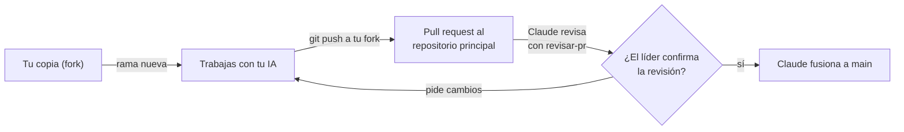

# Equipo y forma de trabajo

Este documento es común para todo el equipo. Cada integrante tiene además su guía personal con sus tareas, paso a paso:

| Persona | Rol | Guía |
|---|---|---|
| Líder ([@rafajaque](https://github.com/rafajaque)) | Líder de arquitectura: base de datos, privacidad, asistente IA, decisiones finales | [`guia-rafael.md`](guia-rafael.md) |
| Alejandro | Interfaz y diseño: portal, componentes, accesibilidad, rendimiento | [`guia-alejandro.md`](guia-alejandro.md) |
| Cristóbal | Datos y contenido: fuentes oficiales, carga de datos, cálculos, textos | [`guia-cristobal.md`](guia-cristobal.md) |
| Claude | Revisión de cada cambio, documentación, verificación de fuentes, fusión a `main` | — |

**Entrega final: 2 de diciembre de 2026.**

> **¿Primera vez con GitHub?** Empieza por [`primeros-pasos-github.md`](primeros-pasos-github.md): instalación, conexión de tu IA, el ciclo de cada tarea comando por comando y tu semana 1 día por día.

---

## 1. Cómo se trabaja: el camino de un cambio



1. **Nunca trabajas directo en el repositorio principal.** Trabajas en tu copia personal (fork) y desde ahí propones cambios.
2. **Una tarea = una rama = un pull request (PR).** Nada de mezclar dos tareas.
3. **Abres el PR** desde tu fork hacia `AE-SE/Agencia-de-Enlaces-y-Seguimiento-Estudiantil`, rama `main`, completando la plantilla.
4. **Avisas en el grupo del equipo** con el enlace del PR.
5. **Claude revisa** con la pauta [`revisar-pr`](../../.claude/skills/revisar-pr/SKILL.md) y el líder confirma o pide cambios.
6. **Si hay cambios pedidos:** los haces en la misma rama y vuelves a subir. El PR se actualiza solo.
7. **Claude fusiona** a `main` como un solo commit. El líder cierra el PR.
8. **Actualizas tu fork** antes de empezar la siguiente tarea (sección 3).

Tiempo esperado de revisión: dentro del mismo día si avisas antes de las 20:00.

---

## 2. Preparación (una sola vez)

### 2.1 Programas

| Programa | Versión | Para qué |
|---|---|---|
| Git | La más reciente | Control de versiones |
| Node.js | Versión LTS vigente | La aplicación web (Next.js) |
| Python | 3.12 o superior | Scripts de datos y de diseño |
| Editor | VS Code u otro | Escribir código |

### 2.2 Acceso al repositorio

1. Acepta la invitación de GitHub que te llegó por correo. Tu permiso en el repositorio principal es de **lectura**: puedes hacer fork y abrir PR desde él, pero no puedes escribir directo en el principal. Así un push por error a `main` es imposible.
2. Entra a https://github.com/AE-SE/Agencia-de-Enlaces-y-Seguimiento-Estudiantil y haz clic en **Fork** (arriba a la derecha). Se crea tu copia en tu cuenta.
3. Clona **tu fork** (no el principal) y conéctalo con el principal:

```bash
git clone https://github.com/TU_USUARIO/Agencia-de-Enlaces-y-Seguimiento-Estudiantil.git
cd Agencia-de-Enlaces-y-Seguimiento-Estudiantil
git remote add principal https://github.com/AE-SE/Agencia-de-Enlaces-y-Seguimiento-Estudiantil.git
git remote -v   # debe mostrar "origin" (tu fork) y "principal"
```

4. Configura tu nombre y correo para que tus commits queden a tu nombre:

```bash
git config user.name "Tu Nombre"
git config user.email "tu-correo@ejemplo.cl"
```

5. Instala las dependencias de los scripts y verifica que todo funcione:

```bash
pip install -r scripts/requirements.txt
python3 scripts/tokens.py --check   # debe decir [ok] 36 veces
```

### 2.3 Tu IA de confianza

Al empezar **cada conversación** con tu IA, entrégale en este orden:

1. [`AGENTS.md`](../../AGENTS.md) completo.
2. Este archivo.
3. Tu guía personal.
4. La skill de [`.claude/skills/`](../../.claude/skills/) de la tarea.
5. La tarea concreta (cada tarea de tu guía trae un texto listo para copiar).

Si usas Claude Code, los pasos 1 y 4 los hace solo.

---

## 3. Comandos del día a día

```bash
# Antes de empezar una tarea: traer lo último del principal
git checkout main
git pull principal main
git push origin main

# Crear la rama de la tarea
git checkout -b feat/explorador-de-carreras

# Guardar avances (todas las veces que quieras)
git add -A
git commit -m "feat: agrega filtros por región al explorador"

# Subir a tu fork
git push -u origin feat/explorador-de-carreras
# GitHub te muestra un enlace para crear el pull request: ábrelo
```

**Nombres de rama:** `feat/` funcionalidad, `fix/` corrección, `docs/` documentación, `datos/` carga de datos.
**Mensajes de commit:** en español, empezando con `feat:`, `fix:`, `docs:`, `datos:`, `test:` o `chore:`.

---

## 4. Calendario

| Semana | Fechas | Líder | Alejandro | Cristóbal |
|---|---|---|---|---|
| 1 · Cimientos | 3 al 9 nov | Esquema de base de datos y seguridad por institución | Proyecto Next.js, tipografías, componentes base, prueba de despliegue | Términos de uso, descarga de bases oficiales, diccionario de datos, primer script |
| 2 · Explorar | 10 al 16 nov | Conexión de datos a la base, autenticación | Ficha de carrera, explorador, comparador, simulador (pantallas) | Empleabilidad e ingresos, cálculo de puntaje y ranking con pruebas |
| 3 · Acompañar | 17 al 23 nov | Asistente IA y protocolo de crisis, consentimientos | Pantallas del asistente, registro, beneficios y calendario | Beneficios y plazos, documentos para el asistente, revisión de textos |
| 4 · Seguir y vender | 24 al 30 nov | Panel de agencia e institucional (lógica) | Paneles (pantallas), accesibilidad, rendimiento | Verificación cruzada de datos, pruebas con 5 usuarios |
| Cierre | 1 y 2 dic | Publicación, presentación | Ajustes finales | Informe de datos |

**Hito al cierre de cada semana** (lunes 9, 16, 23 y 30): algo que se pueda mostrar en un teléfono.

---

## 5. Dependencias entre nosotros

| Quién necesita | Qué | De quién | Para cuándo |
|---|---|---|---|
| Alejandro | Archivos de datos de ejemplo con el formato definitivo | Cristóbal | Jueves 5 nov |
| Cristóbal | Esquema de tablas (nombres de columnas) | Líder | Miércoles 4 nov |
| Alejandro | Funciones de cálculo de puntaje y ranking | Cristóbal | Viernes 13 nov |
| Alejandro | Conexión a la base de datos y autenticación | Líder | Sábado 14 nov |
| Alejandro | Textos revisados de cada pantalla | Cristóbal | El día después de cada pantalla |

Si una dependencia se atrasa, **trabaja con datos de ejemplo** y avisa en el grupo. Nunca te quedes esperando sin decir nada.

---

## 6. Reglas que no se negocian (resumen de AGENTS.md)

- Ningún dato sin fuente oficial, URL y fecha. Si no lo puedes verificar, no se publica.
- Ningún color, tamaño ni espacio escrito a mano: solo tokens de diseño.
- Ningún dato real de estudiantes en tu computador, en una IA externa ni en el repositorio. Datos de prueba siempre ficticios.
- Ninguna clave en el código. Las claves las entrega el líder por un canal privado.
- Ningún "estilo de aprendizaje" (visual/auditivo/kinestésico) en contenidos ni recomendaciones.
- Tú eres responsable del código que subes, aunque lo haya escrito tu IA: léelo y entiéndelo.

---

## 7. Cuando tengas dudas

1. Busca en `AGENTS.md`, `docs/` y tu guía.
2. Pregúntale a tu IA, pasándole esos archivos.
3. Si sigue la duda, **pregunta en el grupo** antes de inventar. Una pregunta de 1 minuto ahorra un PR rechazado.
4. Si tu IA te propone algo que contradice `AGENTS.md`, gana `AGENTS.md`.
